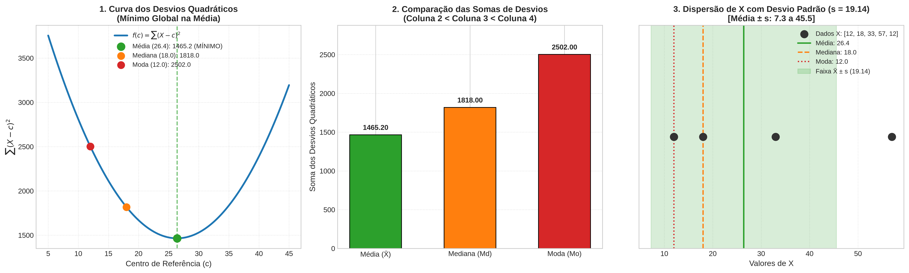

# Atividade Prática: A Média e a Menor Variação dos Dados

> **Curso**: Especialização em Ciência de Dados  
> **Disciplina**: Estatística Aplicada à Ciência de Dados  
> **Professor**: João Maria Filgueira  
> **Tema**: Propriedade dos Mínimos Quadrados da Média e Cálculo do Desvio Padrão Amostral

---

## Sumário

1. [Objetivos da Aula e Apresentação](#1-objetivos-da-aula-e-apresentação)
2. [Fundamentação Teórica](#2-fundamentação-teórica)
   - [Medidas de Tendência Central (Média, Mediana e Moda)](#medidas-de-tendência-central)
   - [A Propriedade Fundamental da Média (Mínimos Quadrados)](#a-propriedade-fundamental-da-média)
   - [Demonstração Matemática por Cálculo Diferencial](#demonstração-matemática)
   - [Do Erro Quadrático ao Desvio Padrão](#do-erro-quadrático-ao-desvio-padrão)
   - [Por que $(n - 1)$? A Correção de Bessel](#por-que-n---1-a-correção-de-bessel)
3. [Passo a Passo da Resolução Numérica](#3-passo-a-passo-da-resolução-numérica)
   - [Passo 1: Dados e Medidas Centrais (Exercício 1.1)](#passo-1-dados-e-medidas-centrais)
   - [Passo 2: Construção do Quadro 1 de Desvios Quadráticos](#passo-2-construção-do-quadro-1)
   - [Passo 3: Comparação das Somas dos Desvios (Exercício 1.2)](#passo-3-comparação-das-somas)
   - [Passo 4: Cálculo Manual do Desvio Padrão vs. Software (Exercício 2)](#passo-4-cálculo-do-desvio-padrão)
4. [Apresentação e Interpretação Visual dos Gráficos](#4-apresentação-e-interpretação-visual-dos-gráficos)
   - [Painel 1: Parábola dos Desvios Quadráticos](#painel-1-parábola-dos-desvios-quadráticos)
   - [Painel 2: Comparação Direta das Somas](#painel-2-comparação-direta-das-somas)
   - [Painel 3: Dispersão dos Dados e Intervalo $\bar{X} \pm s$](#painel-3-dispersão-dos-dados-e-intervalo)
5. [Implementação em Python Comentada](#5-implementação-em-python-comentada)
6. [Como Executar o Projeto](#6-como-executar-o-projeto)
7. [Roteiro Didático para Apresentação em Sala de Aula](#7-roteiro-didático-para-apresentação-em-sala-de-aula)

---

## 1. Objetivos da Aula e Apresentação

Esta atividade prática e expositiva tem como objetivos centrais:

1. **Comprovar empiricamente e algebricamente** que a **Média Aritmética** é a medida de posição central que minimiza a soma dos desvios quadráticos de um conjunto de dados.
2. **Entender a gênese matemática do Desvio Padrão Amostral**, conectando a soma dos desvios quadráticos em relação à média à fórmula da Variância e do Desvio Padrão.
3. **Compreender o conceito de Graus de Liberdade e Correção de Bessel** ($n - 1$).
4. **Integrar teoria, cálculo manual e programação em Python** com visualização gráfica clara para tomada de decisão em Ciência de Dados.

---

## 2. Fundamentação Teórica

### Medidas de Tendência Central

Dadas $n$ observações quantitativas $X = [x_1, x_2, \dots, x_n]$:

| Medida | Símbolo | Definição Intuitiva | Sensibilidade a Extremos (Outliers) |
| :--- | :---: | :--- | :---: |
| **Média** | $\bar{X}$ | Ponto de equilíbrio ou centro de gravidade da distribuição. | **Alta** (é puxada fortemente por valores muito altos ou baixos). |
| **Mediana** | $Md$ | Valor que divide o conjunto ordenado exatamente ao meio (50% abaixo, 50% acima). | **Baixa** (robusta a valores discrepantes). |
| **Moda** | $Mo$ | Valor (ou valores) com maior frequência observada na amostra. | **Nula** para valores isolados fora da moda. |

### A Propriedade Fundamental da Média

> **Teorema**: A soma dos quadrados dos desvios de um conjunto de observações atinge seu **valor mínimo global** quando calculada em torno da **Média Aritmética**.

Defina a função de erro quadrático total $f(c)$, que mede a perda ao representar todos os pontos por uma constante $c$:

$$f(c) = \sum_{i=1}^{n} (x_i - c)^2$$

Se escolhermos:
- $c = \bar{X} \implies f(\bar{X})$ é o menor valor possível.
- $c = Md \implies f(Md) > f(\bar{X})$ (a menos que a distribuição seja perfeitamente simétrica e $\bar{X} = Md$).
- $c = Mo \implies f(Mo) > f(\bar{X})$.

*(Nota histórica e conceitual: enquanto a média minimiza os desvios quadráticos ou norma $L_2$, a mediana minimiza os desvios absolutos $\sum |x_i - c|$ ou norma $L_1$)*.

### Demonstração Matemática

Para encontrar o ponto crítico que minimiza $f(c)$:

1. **Primeira Derivada** em relação a $c$:
   $$\frac{d}{dc} f(c) = \frac{d}{dc} \sum_{i=1}^n (x_i - c)^2 = \sum_{i=1}^n 2(x_i - c) \cdot (-1) = -2 \sum_{i=1}^n (x_i - c)$$

2. **Igualando a zero** para encontrar o ponto crítico:
   $$-2 \sum_{i=1}^n (x_i - c) = 0 \iff \sum_{i=1}^n x_i - \sum_{i=1}^n c = 0$$
   $$\sum_{i=1}^n x_i - n \cdot c = 0 \iff c = \frac{1}{n} \sum_{i=1}^n x_i = \bar{X}$$

3. **Segunda Derivada** (condição de suficiência para mínimo):
   $$\frac{d^2}{dc^2} f(c) = \frac{d}{dc} \left[ -2 \sum_{i=1}^n x_i + 2nc \right] = 2n > 0$$
   Como $n > 0$, a concavidade é voltada para cima em todo o domínio real, provando que **$c = \bar{X}$ é o único mínimo global estrito**.

### Do Erro Quadrático ao Desvio Padrão

Por que elevamos os desvios ao quadrado?
1. Se somarmos os desvios simples $(x_i - \bar{X})$, o resultado é sempre **zero**:
   $$\sum_{i=1}^n (x_i - \bar{X}) = \sum x_i - n\bar{X} = n\bar{X} - n\bar{X} = 0$$
   Os desvios positivos anulam os negativos.
2. Ao elevar ao quadrado, penalizamos variações maiores e eliminamos sinais negativos.

### Por que $(n - 1)$? A Correção de Bessel

A **Variância Amostral** ($s^2$) e o **Desvio Padrão Amostral** ($s$) são definidos como:

$$s^2 = \frac{\sum_{i=1}^n (x_i - \bar{X})^2}{n - 1}$$

$$s = \sqrt{s^2} = \sqrt{\frac{\sum_{i=1}^n (x_i - \bar{X})^2}{n - 1}}$$

**Por que dividir por $(n - 1)$ em vez de $n$?**
- Em uma amostra, a média populacional verdadeira ($\mu$) é desconhecida; utilizamos a média da própria amostra ($\bar{X}$).
- Como $\bar{X}$ foi calculada a partir dos dados observados, a soma $\sum(x_i - \bar{X})^2$ é ligeiramente menor do que seria $\sum(x_i - \mu)^2$.
- Dividir por $n$ subestimaria sistematicamente a dispersão da população (estimador viesado).
- A divisão por $(n - 1)$, conhecida como **Correção de Bessel**, remove esse viés, tornando $s^2$ um estimador não viesado da variância populacional ($\mathbb{E}[s^2] = \sigma^2$).
- Dizemos que foram consumidos **1 grau de liberdade** para estimar a média amostral, restando $(n - 1)$ graus livres para a variabilidade.

---

## 3. Passo a Passo da Resolução Numérica

### Vetor de Dados
Considere a amostra:
$$X = [12, 18, 33, 57, 12] \quad (n = 5)$$

---

### Passo 1: Dados e Medidas Centrais

#### 1. Média Aritmética ($\bar{X}$)
$$\bar{X} = \frac{12 + 18 + 33 + 57 + 12}{5} = \frac{132}{5} = 26{,}40$$

#### 2. Mediana ($Md$)
Ordenando os dados em ordem crescente:
$$X_{\text{ordenado}} = [12, 12, \mathbf{18}, 33, 57]$$
Como $n = 5$ (ímpar), a mediana é o elemento na posição $\frac{5 + 1}{2} = 3^{\underline{a}}$ posição:
$$Md = 18{,}00$$

#### 3. Moda ($Mo$)
O elemento com maior frequência absoluta:
$$Mo = 12{,}00 \quad (\text{aparece 2 vezes})$$

---

### Passo 2: Construção do Quadro 1

Calculamos para cada observação $x_i$ o quadrado de sua distância em relação à média, mediana e moda:

| $X$ (Dados) | $(X - \text{Média})^2 = (X - 26{,}4)^2$ | $(X - \text{Mediana})^2 = (X - 18)^2$ | $(X - \text{Moda})^2 = (X - 12)^2$ |
| :---: | :---: | :---: | :---: |
| **12** | $(12 - 26{,}4)^2 = (-14{,}4)^2 = \mathbf{207{,}36}$ | $(12 - 18)^2 = (-6)^2 = \mathbf{36{,}00}$ | $(12 - 12)^2 = 0^2 = \mathbf{0{,}00}$ |
| **18** | $(18 - 26{,}4)^2 = (-8{,}4)^2 = \mathbf{70{,}56}$ | $(18 - 18)^2 = 0^2 = \mathbf{0{,}00}$ | $(18 - 12)^2 = 6^2 = \mathbf{36{,}00}$ |
| **33** | $(33 - 26{,}4)^2 = (6{,}6)^2 = \mathbf{43{,}56}$ | $(33 - 18)^2 = 15^2 = \mathbf{225{,}00}$ | $(33 - 12)^2 = 21^2 = \mathbf{441{,}00}$ |
| **57** | $(57 - 26{,}4)^2 = (30{,}6)^2 = \mathbf{936{,}36}$ | $(57 - 18)^2 = 39^2 = \mathbf{1521{,}00}$ | $(57 - 12)^2 = 45^2 = \mathbf{2025{,}00}$ |
| **12** | $(12 - 26{,}4)^2 = (-14{,}4)^2 = \mathbf{207{,}36}$ | $(12 - 18)^2 = (-6)^2 = \mathbf{36{,}00}$ | $(12 - 12)^2 = 0^2 = \mathbf{0{,}00}$ |
| **SOMA ($\sum$)** | **$1465{,}20$** | **$1818{,}00$** | **$2502{,}00$** |

---

### Passo 3: Comparação das Somas

Comparando as somas obtidas:
1. **Coluna 2 (Média)**: $\sum (X - \bar{X})^2 = 1465{,}20$
2. **Coluna 3 (Mediana)**: $\sum (X - Md)^2 = 1818{,}00$
3. **Coluna 4 (Moda)**: $\sum (X - Mo)^2 = 2502{,}00$

Verificação das desigualdades:
$$\text{Coluna 2} < \text{Coluna 3} \implies 1465{,}20 < 1818{,}00 \quad \color{green}{\text{[VERDADEIRO]}}$$
$$\text{Coluna 2} < \text{Coluna 4} \implies 1465{,}20 < 2502{,}00 \quad \color{green}{\text{[VERDADEIRO]}}$$

> **Conclusão da Questão 1**: Fica comprovado que a soma dos desvios quadráticos em torno da **Média** é estritamente inferior à soma em relação à Mediana e à Moda.

---

### Passo 4: Cálculo do Desvio Padrão

Seguindo as instruções da Questão 2:
1. Dividir a soma da coluna 2 por $(5 - 1) = 4$:
   $$s^2 = \frac{1465{,}20}{4} = 366{,}3000 \quad (\text{Variância Amostral})$$

2. Extrair a raiz quadrada da divisão:
   $$s = \sqrt{366{,}3000} \approx \mathbf{19{,}138965...} \approx 19{,}1390$$

3. Comparação com o software estatístico (`statistics.stdev` / `numpy.std(ddof=1)`):
   - **Manual**: $19{,}1389655...$
   - **Software**: $19{,}1389655...$
   - **Diferença Absoluta**: $0{,}000000 \times 10^0$ (concordância exata).

---

## 4. Apresentação e Interpretação Visual dos Gráficos

A execução do script gera a imagem [`grafico_desvio_padrao.png`](./grafico_desvio_padrao.png), composta por três painéis analíticos:



### Painel 1: Parábola dos Desvios Quadráticos
- **O que ilustra**: A curva contínua $f(c) = \sum (x_i - c)^2$ para diversos valores de $c$ no intervalo $[5, 45]$.
- **Interpretação para a aula**:
  - A curva forma uma parábola convexa perfeita.
  - O **ponto mais baixo** (vértice) situa-se rigorosamente no ponto verde $(26{,}4; 1465{,}2)$, correspondente à **Média**.
  - A Mediana ($18{,}0$) e a Moda ($12{,}0$) estão posicionadas em ramos ascendentes da curva, com valores de erro quadrático substancialmente maiores ($1818{,}0$ e $2502{,}0$).

### Painel 2: Comparação Direta das Somas
- **O que ilustra**: Gráfico de barras destacando a magnitude da soma dos desvios para Média, Mediana e Moda.
- **Interpretação para a aula**:
  - Mostra visualmente a discrepância: adotar a Moda gera um erro acumulado $70{,}7\%$ maior que a Média ($2502{,}00$ vs $1465{,}20$).
  - Adotar a Mediana gera um erro acumulado $24{,}1\%$ maior ($1818{,}00$ vs $1465{,}20$).

### Painel 3: Dispersão dos Dados e Intervalo $\bar{X} \pm s$
- **O que ilustra**: A distribuição dos dados no eixo horizontal, as três medidas centrais e a faixa de dispersão $[\bar{X} - s, \bar{X} + s]$.
- **Interpretação para a aula**:
  - Os dados $[12, 12, 18, 33]$ concentram-se à esquerda, enquanto o valor $57$ atua como um ponto extremo à direita (assimetria positiva).
  - Por causa do valor $57$, a Média ($26{,}4$) é deslocada para a direita em relação à Mediana ($18{,}0$) e Moda ($12{,}0$).
  - O desvio padrão $s = 19{,}14$ define uma faixa de normalidade típica: $[26{,}4 - 19{,}14; 26{,}4 + 19{,}14] = [7{,}26; 45{,}54]$.
  - Quatro dos cinco dados ($80\%$) estão dentro desta primeira faixa de dispersão em torno da média.

---

## 5. Implementação em Python Comentada

O código completo está implementado em [`atividade_desvio_padrao.py`](./atividade_desvio_padrao.py). A seguir, destacamos as seções-chave:

```python
import math
import statistics
from collections import Counter
import pandas as pd
import numpy as np
import matplotlib.pyplot as plt

# 1. Dados Iniciais
valores = [12, 18, 33, 57, 12]
n = len(valores)

# 2. Medidas de Tendência Central
media = statistics.mean(valores)          # 26.4
mediana = statistics.median(valores)      # 18.0
contagem = Counter(valores)
moda = max(contagem, key=contagem.get)    # 12.0

# 3. Construção do Quadro 1 (Desvios Quadráticos)
col_desv_media = [(x - media) ** 2 for x in valores]
col_desv_mediana = [(x - mediana) ** 2 for x in valores]
col_desv_moda = [(x - moda) ** 2 for x in valores]

soma_media = sum(col_desv_media)          # 1465.20
soma_mediana = sum(col_desv_mediana)      # 1818.00
soma_moda = sum(col_desv_moda)            # 2502.00

# 4. Prova da Desigualdade
print(soma_media < soma_mediana)          # True
print(soma_media < soma_moda)             # True

# 5. Cálculo do Desvio Padrão Amostral (Exercício 2)
graus_liberdade = n - 1                   # 4
variancia_calculada = soma_media / graus_liberdade
desvio_padrao_calculado = math.sqrt(variancia_calculada) # 19.1390

# Comparação com biblioteca estatística
desvio_padrao_software = statistics.stdev(valores)
assert math.isclose(desvio_padrao_calculado, desvio_padrao_software)
```

---

## 6. Como Executar o Projeto

No terminal, a partir da raiz do repositório:

```bash
# 1. Ativar o ambiente virtual configurado
source .venv/bin/activate

# 2. Executar o script estatístico
python estatistica/atividade_desvio_padrao.py
```

O script imprimirá no terminal a memória de cálculo completa, as tabelas formatadas e salvará o arquivo de alta resolução [`grafico_desvio_padrao.png`](./grafico_desvio_padrao.png) na pasta `estatistica/`.

---

## 7. Roteiro Didático para Apresentação em Sala de Aula

Utilize esta sequência sugerida de **10 a 15 minutos** para conduzir a apresentação aos colegas e professor:

| Bloco | Duração | Ação do Apresentador | Slide / Imagem / Recurso |
| :---: | :---: | :--- | :--- |
| **1. Introdução e Provocação** | 2 min | Apresentar o vetor de dados $X = [12, 18, 33, 57, 12]$ e fazer a pergunta à turma: *"Qual medida central melhor resume esses dados e por que a média é a base do desvio padrão e da regressão linear?"* | Apresentar o enunciado da atividade. |
| **2. Medidas Centrais** | 2 min | Mostrar a diferença entre Média ($26{,}4$), Mediana ($18{,}0$) e Moda ($12{,}0$). Destacar como o valor $57$ distorce a média para a direita. | Quadro 1 (coluna de dados e resultados). |
| **3. A Prova Empírica** | 3 min | Exibir a tabela com as 3 colunas de desvios quadráticos. Mostrar que $\sum(X - \bar{X})^2 = 1465{,}20$, superando Mediana ($1818{,}00$) e Moda ($2502{,}00$). | Painel 2 do gráfico (barras coloridas). |
| **4. A Demonstração Geométrica** | 3 min | Exibir a curva contínua $f(c)$. Demonstrar que a Média é exatamente o vértice da parábola ($\frac{df}{dc} = 0$). | Painel 1 do gráfico (parábola com os 3 pontos). |
| **5. Transição para o Desvio Padrão** | 3 min | Conectar a soma mínima ($1465{,}20$) à fórmula do desvio padrão: divisão por $n - 1 = 4$, raiz quadrada $\approx 19{,}14$ e a equivalência exata com o software. Explicar a Correção de Bessel. | Painel 3 do gráfico (faixa $\bar{X} \pm s$). |
| **6. Perguntas e Fechamento** | 2 min | Concluir com a mensagem: *"A média não é apenas uma média aritmética simples; ela é a estimativa ótima de mínimos quadrados em modelos lineares."* Abrir para dúvidas. | Conclusão geral e código-fonte. |

---

### Perguntas Provocativas para Estimular a Turma
- *"Se trocássemos a função quadrática por desvios absolutos $|X - c|$, qual medida minimizaria a soma?"*  
  $\rightarrow$ **Resposta**: A **Mediana** (norma $L_1$).
- *"Por que não dividimos por $n = 5$ no desvio padrão da amostra?"*  
  $\rightarrow$ **Resposta**: Porque já gastamos 1 grau de liberdade ao estimar $\bar{X}$ a partir da própria amostra (Correção de Bessel).

